<div align="center">

# 🫀 MESP Health Monitoring Platform

### From wearable sensor bytes to a real-time physiological monitoring console

**Three sensors. One wrist. Every byte accounted for.**

<br/>


<br/>

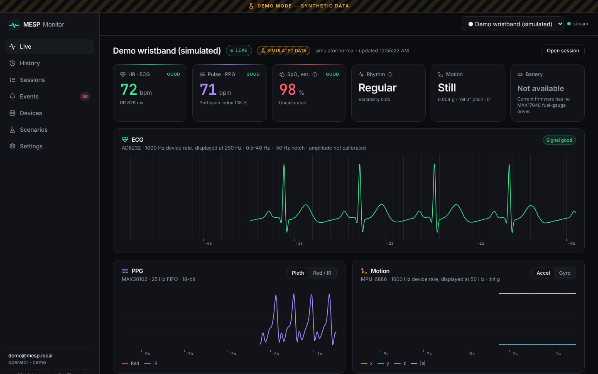

<sub><a href="#-system-architecture">Architecture</a> · <a href="#-protocol-engineering">Protocol</a> · <a href="#-the-timestamp-problem">Timestamps</a> · <a href="#-signal-processing">DSP</a> · <a href="#-performance">Performance</a> · <a href="#-correctness--testing">Testing</a> · <a href="#-security--privacy">Security</a> · <a href="#-quick-start">Quick start</a></sub>

</div>

> [!WARNING]
> **Engineering / research prototype — not a medical device.** MESP does not provide medical diagnosis. Physiological values and alerts are not clinically validated and must not replace professional medical evaluation. Synthetic data is labelled as such everywhere — UI, sessions, events and exports.

---

## ⚡ TL;DR

MESP is the software platform behind a **wrist-worn multi-parameter health monitor**: an STM32G431 sampling **ECG** (AD8232), **PPG** (MAX30102) and **6-axis motion** (MPU-6886), streaming framed bytes over an **nRF52840 BLE bridge**.

This repository takes that raw byte stream all the way to a real-time monitoring console — and the interesting engineering is **everything required to make the dashboard trustworthy about the data it receives**:

- 🧬 **Protocol derived from firmware, not docs** — the firmware's own `nrf_link.c` is compiled on a host to produce golden byte vectors; Python and TypeScript decoders must match byte-for-byte.
- 🛡️ **Loss-aware streaming** — CRC, false-sync-resistant deframing, sequence-gap loss accounting (exact against injected loss), duplicate suppression.
- ⏱️ **Timestamps for a protocol that has none** — per-stream clock reconstruction with drift correction and gap detection.
- 🧠 **Server-side DSP** — Pan-Tompkins-style R-peaks, RR irregularity, motion-gated SpO₂ estimate, fall heuristic.
- 💾 **1-second Float32 chunks** — ~2,000 raw samples/s per device become **3 rows/s**.
- ⚡ **Canvas waveforms** over Float32 ring buffers kept *outside* React state.
- 🧪 **Byte-exact simulator** with 10 deterministic scenarios — hardware, recordings and simulation all use **one code path**.

---

## 🖥️ Product

<p align="center">
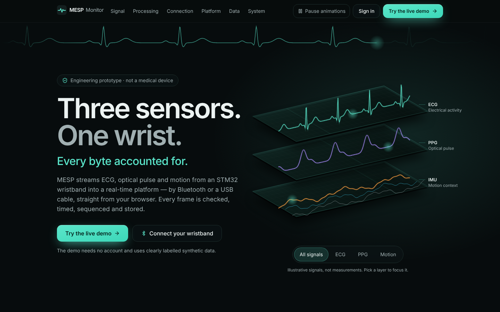
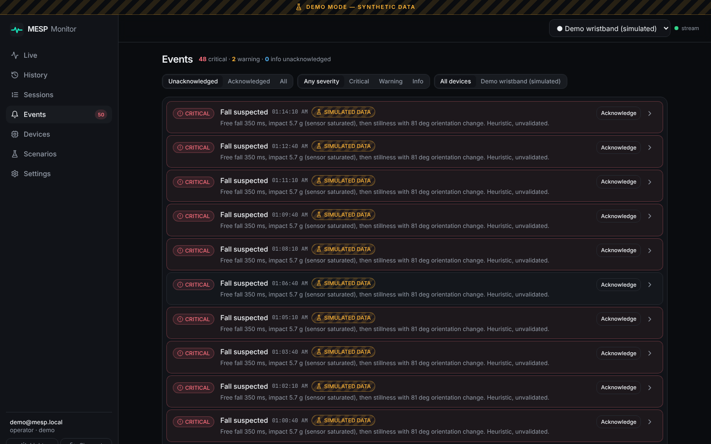
</p>
<p align="center">
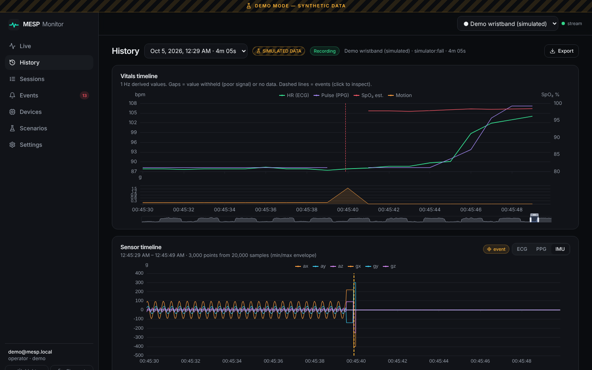
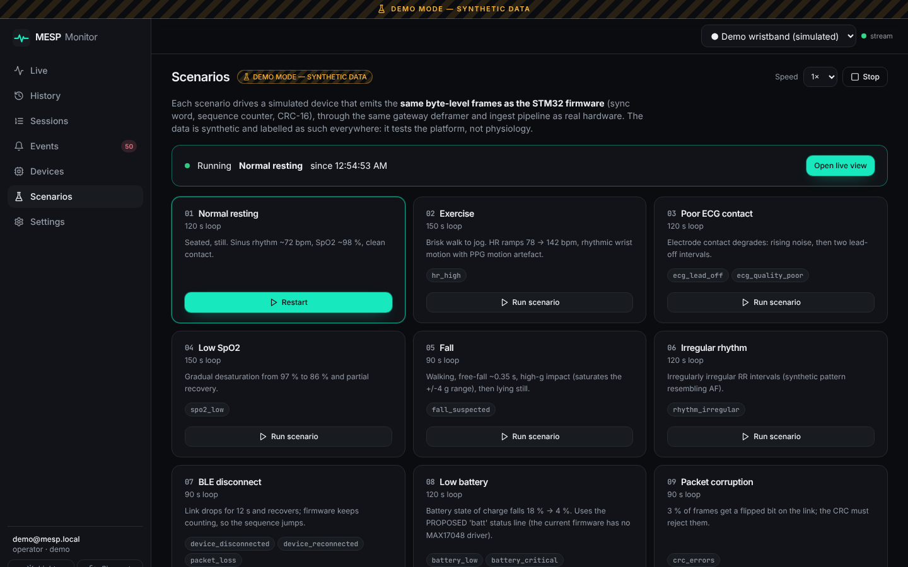
</p>

| Monitoring | Data & history | Operations |
|---|---|---|
| Real-time ECG, PPG/pleth, accelerometer and gyroscope | Zoomable historical sensor timelines with min/max envelopes | Device pairing with per-device ingest keys |
| Heart-rate and pulse-rate estimates | Event click-through to the exact time window | Packet-loss and CRC telemetry per device |
| Uncalibrated, motion-gated SpO₂ estimate | Session analytics: ECG vs PPG HR, SpO₂ distribution, activity / quality | Sessions and scenarios |
| ECG quality and lead-off state | CSV / JSON export with provenance + synthetic label | Event acknowledgement with audit log |
| Activity, orientation, heuristic fall events | Configurable raw-data retention | Responsive light/dark UI, mobile navigation |

---

## 🧭 System architecture

```mermaid
flowchart LR
    subgraph HW["⌚ Wristband (MESP_lab firmware)"]
        direction TB
        SENS["🫀 AD8232 ECG · 1 kHz<br/>🩸 MAX30102 PPG · 25 Hz<br/>🧭 MPU-6886 IMU · 1 kHz"]:::hw
        MCU["🔲 STM32G431<br/>DMA · framing · CRC"]:::hw
        NRF["📶 nRF52840<br/>BLE UART bridge"]:::ble
        SENS --> MCU -- "UART 1 Mbaud<br/>RTS/CTS" --> NRF
    end

    GW["📡 mesp-gateway<br/>BLE · serial · replay · simulator<br/>deframe · link state · backoff"]:::gw

    subgraph API["⚙️ FastAPI ingest pipeline"]
        direction TB
        P1["🔍 CRC + schema"]:::api --> P2["🔢 sequence · loss · dedup"]:::api --> P3["⏱️ timestamp reconstruction"]:::api --> P4["📐 device-profile decode"]:::api --> P5["🧠 DSP"]:::dsp --> P6["🚨 event engine"]:::ev
    end

    DB[("🐘 PostgreSQL<br/>1 s Float32 chunks")]:::db
    UI["🖥️ React console<br/>canvas waveforms"]:::ui

    NRF -- "BLE NUS" --> GW -- "WebSocket<br/>raw frames" --> API
    P4 --> DB
    P6 --> DB
    API -- "live WebSocket" --> UI
    DB -- "REST history" --> UI

    classDef hw fill:#03234B,stroke:#011428,color:#fff
    classDef ble fill:#0082FC,stroke:#005BB5,color:#fff
    classDef gw fill:#6A1B9A,stroke:#4A148C,color:#fff
    classDef api fill:#009688,stroke:#00695C,color:#fff
    classDef dsp fill:#E65100,stroke:#BF360C,color:#fff
    classDef ev fill:#C62828,stroke:#B71C1C,color:#fff
    classDef db fill:#336791,stroke:#1E3F5A,color:#fff
    classDef ui fill:#20232A,stroke:#61DAFB,color:#61DAFB
    style HW fill:transparent,stroke:#03234B,stroke-dasharray:5 5
    style API fill:transparent,stroke:#009688,stroke-dasharray:5 5
```

### One code path for hardware and simulation

> **Rule:** hardware, recordings and simulation must enter the *same* downstream pipeline.

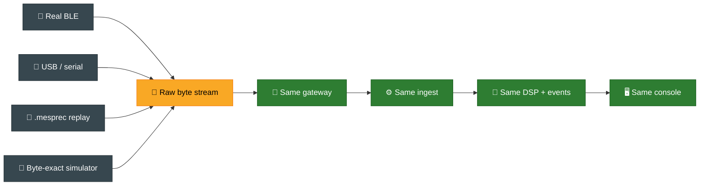

The demo is not a separate fake application. The simulator produces firmware-compatible frames that exercise the same gateway, ingest, storage, analysis, event and WebSocket paths as the real wristband.

---

## 🧬 Protocol engineering

The wire protocol was **read from the firmware source** (`nrf_link.c` in MESP_lab) and verified byte-for-byte — not guessed from documentation.

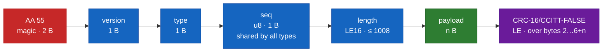

| Type | Value | Payload | Firmware batching |
|---|---|---|---|
| `PPG_RAW` | `0x01` | n × 6 B: red(3) ir(3), 18-bit big-endian | ~1 sample/frame at 25 Hz |
| `IMU_RAW` | `0x02` | n × 14 B: ax ay az temp gx gy gz, int16 BE | ~5 records/frame |
| `STATUS` | `0x03` | ASCII | not emitted by current firmware |
| `TEXT` | `0x04` | ASCII | `boot:` line once, `stats …` every 1 s |
| `ECG_RAW` | `0x05` | n × 2 B: 12-bit ADC, uint16 BE | 32 samples/frame (DMA half-buffer) |

The wire carries **no timestamps, sample rates, full-scale ranges or device ID** — these come from a pinned **device profile**, and a profile mismatch detected from the `boot:` line raises an event.

### 🔬 Firmware-derived golden vectors

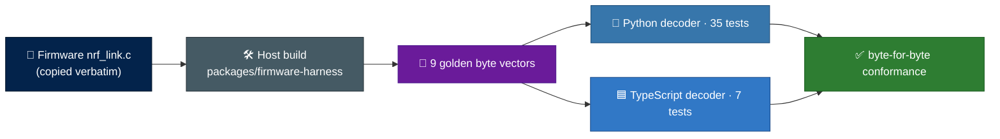

Compiling the real firmware framing code resolved two details the documentation left ambiguous: **CRC byte order**, and that **one sequence counter is shared across all frame types**.

---

## 🛡️ Loss, corruption and duplicate handling

> A wearable stream cannot assume *"if bytes arrived, the data is correct."*

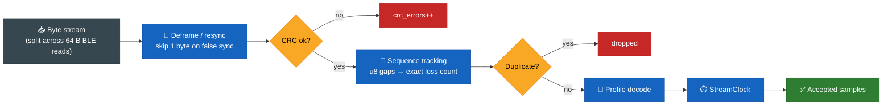

- On a CRC mismatch the deframer skips **one byte**, never the claimed length — so an embedded `AA 55` can't swallow the frames that follow.
- Tracked per device: CRC failures, sequence gaps, duplicates, timestamp gaps, disconnects, stale streams and ingest latency.
- Injected packet loss in the simulator is **counted exactly** from sequence gaps (tested).

---

## ⏱️ The timestamp problem

> **How do you put a 1 kHz stream on a stable timeline when the device sends no timestamps and packets arrive over an unreliable link?**

Each stream (`ecg`, `ppg`, `imu`) gets its own `StreamClock`:

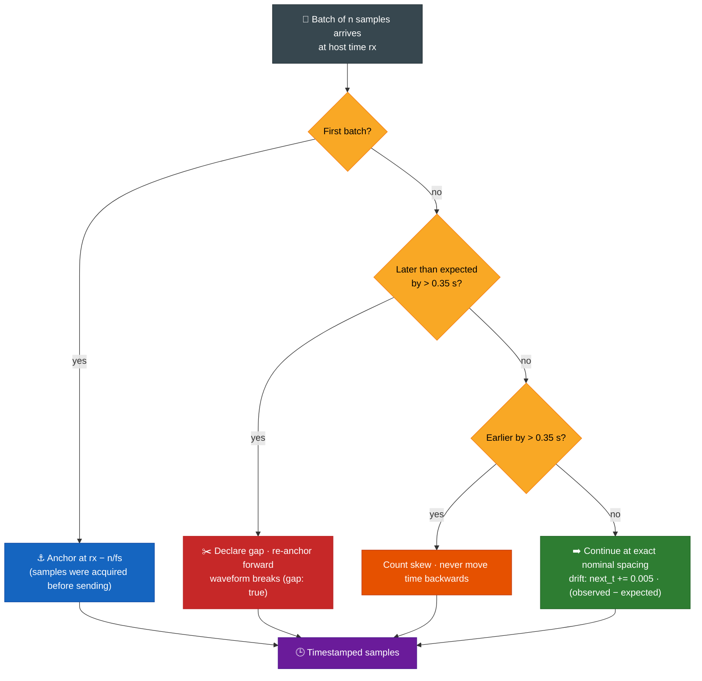

Sample spacing is exact at the nominal rate, crystal drift between the STM32 and the host is absorbed slowly without jitter, stored data never overlaps, and sequence gaps stay separate from timestamp gaps. The documented limit: absolute time is only as good as BLE delivery latency, which is **not yet measured** ([ADR-005](docs/decisions/ADR-005-timestamps.md), [timestamps.md](docs/architecture/timestamps.md)).

---

## 🧠 Signal processing

MESP **recomputes derived values server-side** instead of trusting untransmitted firmware debug output.

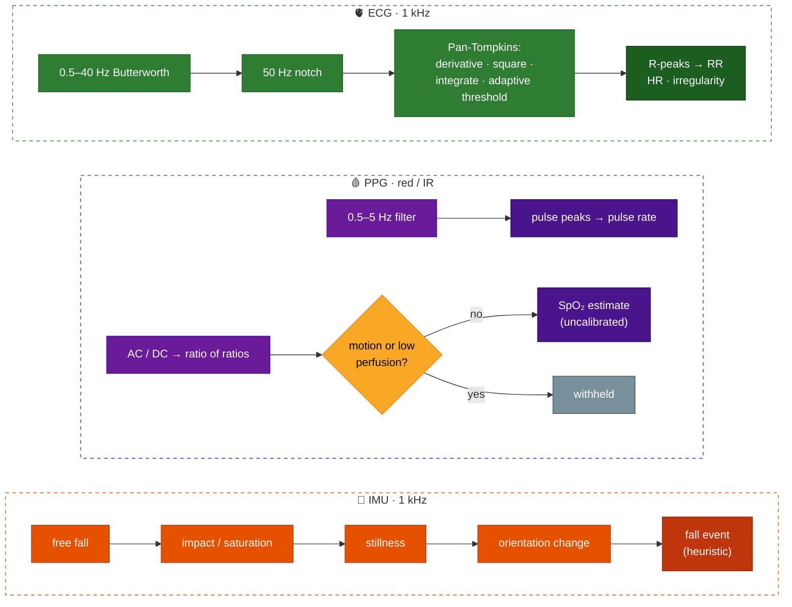

- **ECG:** waveform, R-peaks, HR, RR intervals, beat-interval irregularity, quality and a lead-off heuristic. **HR is withheld when signal quality is insufficient.**
- **PPG:** in the exercise scenario, wrist PPG locks onto arm-swing cadence (~150 bpm). Without motion-artefact cancellation, a confident SpO₂ number would be more misleading than none — so **under motion or low perfusion the estimate is withheld**.
- **IMU:** acceleration magnitude, activity level, orientation, die temperature and a fall heuristic that handles accelerometer saturation. Explicitly **not clinically validated**.

### 🚨 Event engine — signal processing is separate from event policy

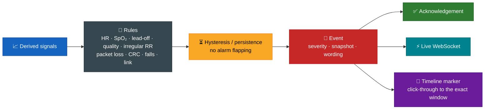

---

## 🧪 Byte-exact simulator, replay and gateway

The simulator is not random JSON pretending to be a device — it emits **firmware-compatible framed bytes** with the firmware's batching and rates. **Ten deterministic scenarios**, each of which asserts the events it should raise (and `normal` asserts none):

| 🟢 Physiology | 🟠 Sensor & device | 🔴 Link faults |
|---|---|---|
| `normal` · `exercise` · `irregular rhythm` · `low SpO₂` · `fall` | `poor ECG contact` · `low battery` | `BLE disconnect` · `packet corruption` · `packet loss` |

Recordings use the `.mesprec` format and replay at any speed, with seek and loop — **determinism + reproducibility + hardware-independent development**.

The **gateway** normalises `BleSource`, `SerialSource`, `ReplaySource` and `SimulatorSource` behind one async interface, forwards only valid frames, and tracks link state:

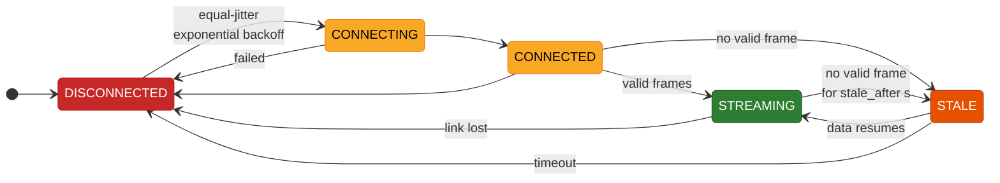

During API outages the WebSocket uplink keeps a **bounded drop-oldest backlog**, and a graceful shutdown sends `bye` so normal disconnects aren't mistaken for failures.

---

## 💾 Storage design

Raw physiological streams are **not** stored as one row per sample. Each stream is sliced into 1-second Float32 chunks:

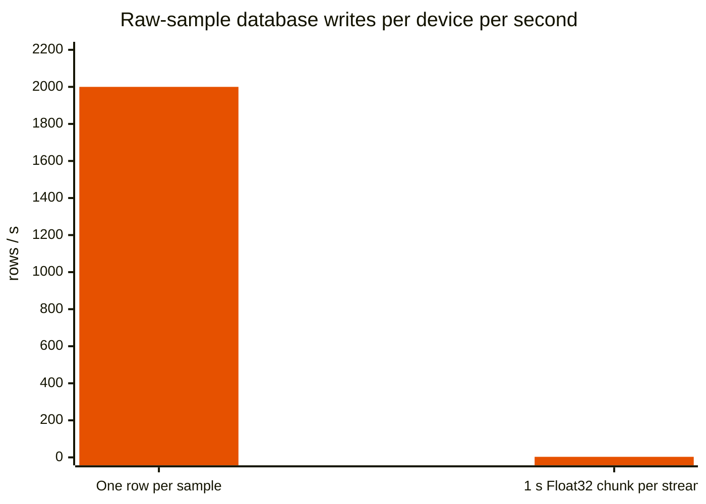

- ~2,000 raw samples/s/device → **3 rows/s** for the three primary streams — chosen deliberately instead of adding TimescaleDB ([ADR-004](docs/decisions/ADR-004-storage.md)).
- Range queries return **min/max envelopes**, so ECG peaks stay visible when zoomed out.
- Configurable retention; deleting a device cascades through sessions, samples, vitals and events.

## ⚡ Live console


250 Hz ECG display with gap breaks, pause, zoom, pan, fullscreen and keyboard control. The UI models **six explicit data states** — `LIVE` · `STALE` · `DISCONNECTED` · `LOADING` · `ERROR` · `NO DATA` — so stale numbers are never shown as if they were current.

**Accessibility:** axe WCAG 2 A/AA checks in E2E, light + dark themes — **zero serious/critical violations** on the scanned pages; keyboard controls, reduced-motion support, responsive down to 390 px.

---

## 📈 Performance

Load tests on a **2-vCPU** x86_64 box: Python 3.13, PostgreSQL 16 and the load generator on the same machine, single API worker, synthetic `normal` scenario (~257 frames/s per device). Details: [`docs/testing/load-results.md`](docs/testing/load-results.md).

| Test | Result |
|---|---|
| **Max ingest** — 1 device pushes 60 s of data as fast as accepted | 15,436 frames in 2.42 s → **~6,400 frames/s**, 24.8× real time, **0 lost** |
| **8 devices**, real-time pace, 30 s | all 61,744 frames accounted for · p50 **31.9 ms** · worst p95 **176.5 ms** |
| **16 devices**, real-time pace, 30 s | all frames accounted for · p50 **41.3 ms** · worst p95 **336 ms** |
| **32 devices**, real-time pace, 30 s | all frames accounted for, but **saturated** · p50 5.6 s · p95 14.8 s |

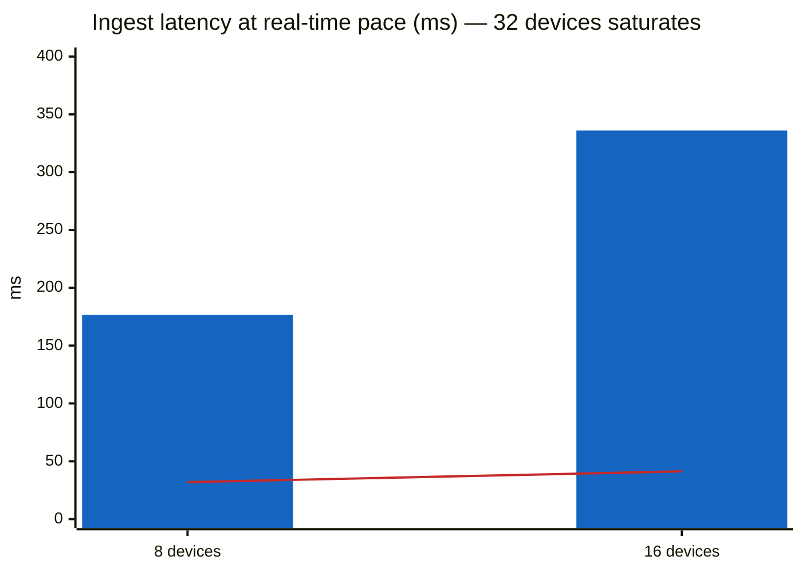

<sub>🟦 bars = worst p95 · 🟥 line = p50</sub>

**Takeaway:** one API process sustains **~16 devices in real time with sub-second p95** on 2 vCPUs. The measured bottleneck is single-threaded Python DSP + per-second PostgreSQL inserts; the scale-out path (DSP workers, Redis/NATS fan-out) is in [ADR-003](docs/decisions/ADR-003-in-process-live-hub.md). Ingest latency excludes the BLE air interface, which is not yet measured.

---

## 🧪 Correctness & testing

**122 automated tests** — and they deliberately **cross process and language boundaries**.

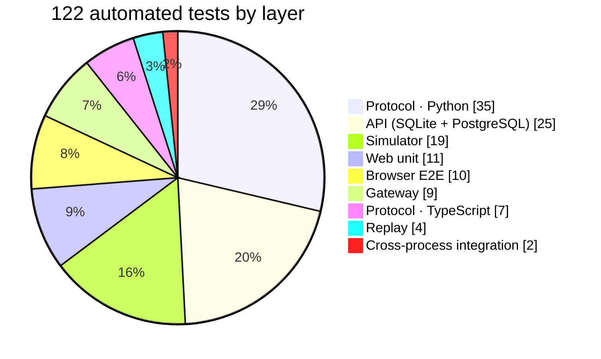

| Layer | What it proves | Count |
|---|---|---|
| Firmware conformance | Golden frames regenerated from the vendored `nrf_link.c` | 9 vectors |
| Protocol (Python) | CRC, every vector, encoder round-trip, chunking, resync, false sync, fuzz | 35 |
| Protocol (TypeScript) | Same vectors | 7 |
| Simulator | 10 scenarios valid, determinism, firmware batching/rates, loss/corruption/disconnect accounting | 19 |
| Replay | Format round-trip, truncation, real-time pacing, speed, seek, loop | 4 |
| Gateway | Ingest codec, link state machine, backoff, only-valid-frames forwarding | 9 |
| API | Auth, rate limit, RBAC, keys, end-to-end ingest, **every scenario raises its expected event**, exact loss counting, ack flow, live WS, exports, cascade delete — on **SQLite and PostgreSQL** | 25 |
| Integration | **Real uvicorn process + real `mesp-gateway` process** over WebSocket (sim and replay), graceful `bye` | 2 |
| Web unit | Ring buffer, live-client state machine, freshness mapping, components | 11 |
| Browser E2E | Demo draws, keyboard controls, scenario → event → ack → timeline, export labelling, **axe WCAG 2 A/AA**, mobile layout | 10 |

> All physiological expectations are tested against **simulated data**: they prove the pipeline computes what it was designed to compute on known inputs — not accuracy on real people.

---

## 🔐 Security & privacy

Physiological recordings become sensitive health data once they belong to real people, so they are treated as security assets alongside device keys, credentials, the JWT secret and the audit trail.

| Area | Controls |
|---|---|
| 🔑 Accounts | bcrypt hashing · IP + email sliding-window rate limits · short-lived HS256 JWTs in `sessionStorage` · server-side RBAC |
| 📟 Devices | Random 256-bit per-device ingest keys, stored only as SHA-256 hashes |
| ⚡ WebSocket | Token sent in a message, never in the URL · bounded live queues |
| 🧱 Input | Strict frame parsing · server-side CRC re-validation · Pydantic validation · upload size limits |
| 🌐 HTTP | Generic 500s · security headers · CSP in nginx |
| 📜 Accountability | Audit log (logins, user and device changes, key rotation, deletions, exports) · synthetic-data provenance through exports |
| 🕶️ Privacy | No names, dates of birth or identity fields required · configurable raw-data retention · cascading deletes |

**Documented gaps** ([threat model](docs/security/threat-model.md)): TLS terminates at a reverse proxy; no refresh tokens or server-side revocation; in-process rate limiting; no application-level encryption at rest; BLE uses an open Nordic UART Service without bonding.

---

## 🚀 Quick start

**Local development** (Python ≥ 3.11, Node.js; SQLite is enough for the demo):

```bash
make install
make dev-api      # API in demo mode on :8000 (SQLite)
make dev-web      # console on :5173 (proxies /api to :8000)
```

Open `http://localhost:5173` and choose **Explore the demo**.

**Docker** (PostgreSQL + API + nginx-served web):

```bash
cp .env.example .env     # set POSTGRES_PASSWORD, MESP_JWT_SECRET, MESP_ADMIN_EMAIL, MESP_ADMIN_PASSWORD
docker compose up --build -d
# → http://localhost:8080
```

**Real hardware** — set `NRF_LINK_ENABLED 1` in the MESP_lab firmware, flash the STM32 and the XIAO nRF52840 bridge, then:

```bash
mesp-gateway --source ble --ble-name MESP-Health \
  --api ws://<api-host>:8000/api/v1/ingest/ws --record session.mesprec

mesp-gateway --source serial --port /dev/ttyUSB0 --baud 1000000   # without the BLE bridge
mesp-gateway --source replay --file session.mesprec                # replay a recording
```

<details>
<summary><b>🧰 All developer commands</b></summary>

```bash
make install      # install everything
make vectors      # regenerate firmware conformance vectors
make lint
make test-py      # protocol · simulator · replay · gateway · API · integration
make test-web     # frontend unit tests
make test         # lint + test-py + test-web
make e2e          # Playwright browser E2E
make up / down    # docker compose
make load         # load test
```

</details>

**Deployment model:** static React frontend on Vercel + FastAPI on a container host (Render) with PostgreSQL — the API needs long-lived WebSockets and a background demo simulator, so it can't be serverless. Configs: `vercel.json`, `render.yaml`. No public instance has been deployed. Full guide: [`docs/deployment/README.md`](docs/deployment/README.md).

---

## 🗂️ Repository layout

```text
Mesp_platform/
├── apps/
│   ├── api/                    # FastAPI: ingest pipeline · DSP · events · REST · WebSocket
│   └── web/                    # React + TypeScript monitoring console
├── services/gateway/           # BLE / serial / replay / simulator gateway
├── packages/
│   ├── protocol/               # Python + TypeScript wire protocol + golden vectors
│   ├── firmware-harness/       # host build of the firmware's nrf_link.c
│   ├── types/                  # shared TypeScript types
│   └── ui/                     # design tokens
├── simulator/                  # byte-exact device simulator (10 scenarios)
├── replay/                     # .mesprec record / replay
├── database/                   # Alembic migrations
├── docker/                     # Dockerfiles + nginx
├── tests/                      # integration/ (real processes) · load/
└── docs/                       # architecture · protocol · decisions · security · testing · deployment · REPORT
```

## 📚 Documentation & decisions

| Topic | Doc | | ADR | Decision |
|---|---|---|---|---|
| Architecture | [overview](docs/architecture/overview.md) | | [001](docs/decisions/ADR-001-monorepo.md) | Monorepo |
| Timestamps | [timestamps](docs/architecture/timestamps.md) | | [002](docs/decisions/ADR-002-gateway-forwards-raw-frames.md) | Gateway forwards raw frames |
| Link protocol | [link-protocol-v1](docs/protocol/link-protocol-v1.md) | | [003](docs/decisions/ADR-003-in-process-live-hub.md) | In-process live hub |
| Ingest protocol | [ingest-protocol-v1](docs/protocol/ingest-protocol-v1.md) | | [004](docs/decisions/ADR-004-storage.md) | PostgreSQL chunk storage |
| Live WebSocket | [live-websocket-v1](docs/protocol/live-websocket-v1.md) | | [005](docs/decisions/ADR-005-timestamps.md) | Timestamp reconstruction |
| REST API | [api](docs/api/README.md) · [openapi.json](docs/api/openapi.json) | | [006](docs/decisions/ADR-006-rendering.md) | Canvas waveform rendering |
| Threat model | [threat-model](docs/security/threat-model.md) | | [007](docs/decisions/ADR-007-demo-mode.md) | Demo mode |
| Technical report | [REPORT](docs/REPORT.md) | | [008](docs/decisions/ADR-008-auth.md) | Authentication |

---

## 📋 Verified vs. not yet proven

| ✅ Verified | ⏳ Not yet measured / implemented |
|---|---|
| Firmware framing vectors match byte-for-byte | Clinical HR and SpO₂ accuracy |
| Python + TypeScript protocol conformance | Fall-detection sensitivity / specificity |
| 122 automated tests, Python on SQLite **and** PostgreSQL | BLE range and air-interface latency |
| Exact injected-loss accounting | Throughput under real RF conditions |
| Real-process gateway ↔ API integration | Battery gauge, skin temperature (not in firmware) |
| ~6,400 frames/s max ingest; 16 devices real time at p95 ≤ 336 ms | Public hosted instance |
| WCAG 2 A/AA automated checks, both themes | Multi-replica live hub |
| Synthetic-data provenance through exports | |

---

<div align="center">

### From a sensor pin to a browser pixel.

**If the system cannot explain where a number came from, when it was measured, whether data was lost, and whether it is synthetic — it should not pretend the number is trustworthy.**

<sub>MIT © Siddhant Singh · Not a medical device</sub>

</div>
